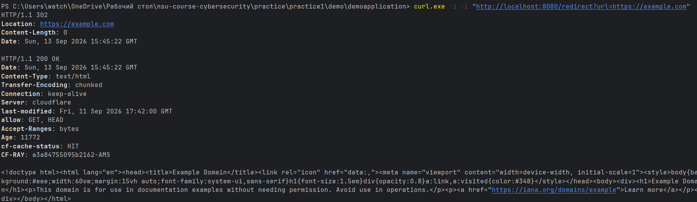
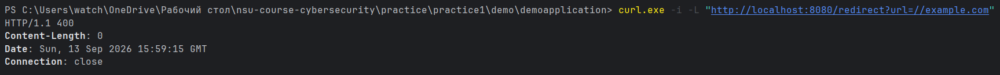

# Open Redirect

## Описание уязвимости

Open Redirect - уязвимость, при которой пользователь может самостоятельно указать адрес, на который приложение выполнит перенаправление. Это позволяет использовать доверенный сайт для перенаправления пользователя на сторонний или вредоносный ресурс.

## Уязвимая реализация

В приложение был добавлен эндпоинт:

GET /redirect?url=...

Он принимает URL от пользователя и без проверки возвращает HTTP-ответ `302` с указанным адресом в заголовке `Location`.

Пример:

GET /redirect?url=https://example.com

Сервер возвращает:

HTTP/1.1 302
Location: https://example.com

Таким образом, пользователь может указать произвольный адрес для перенаправления.

## PoC

Для демонстрации используется curl:

    curl.exe -i -L "http://localhost:8080/redirect?url=https://example.com"

В результате приложение возвращает `302 Redirect`, после чего curl переходит на `https://example.com`.

### Скриншот эксплуатации



## Исправление

В исправленной версии перед выполнением перенаправления URL проверяется.

Перенаправление разрешается только на заранее допустимые адреса/домены или на внутренние относительные пути приложения. Если переданный URL не соответствует разрешённым значениям, приложение отклоняет запрос.

Таким образом, пользователь больше не может использовать эндпоинт для перенаправления на произвольный внешний ресурс.


## Код
```java
@GetMapping("/sredirect")
    public ResponseEntity<Void> safeRedirect(@RequestParam String url) {
        if (!url.startsWith("/") || url.startsWith("//")) {
            return ResponseEntity.badRequest().build();
        }
        return ResponseEntity
                .status(HttpStatus.FOUND)
                .location(URI.create(url))
                .build();
    }
    @GetMapping("/redirect")
    public ResponseEntity<Void> redirect(@RequestParam String url) {
        return ResponseEntity
                .status(HttpStatus.FOUND)
                .location(URI.create(url))
                .build();
    }
```
